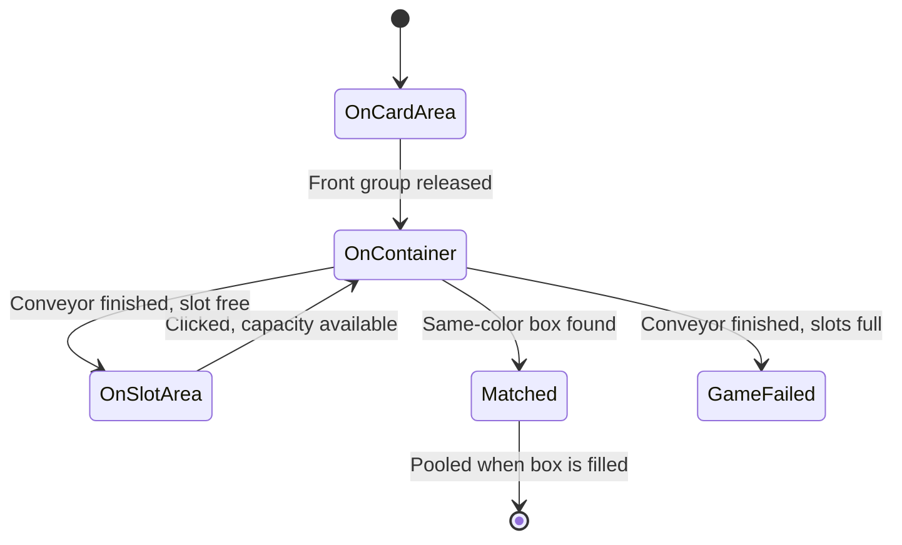
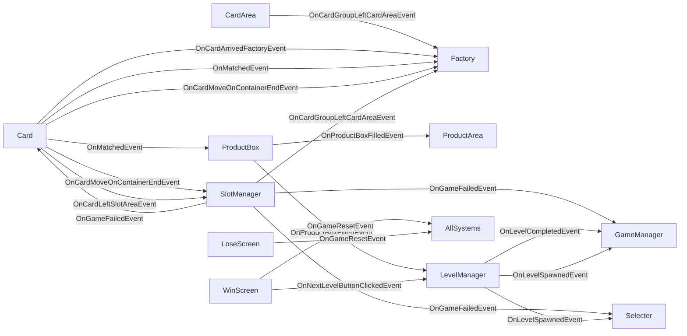

<div align="center">

# 🏭 Card Factory — Unity

A Card Factory-style sorting puzzle clone built in **Unity (C#)**, featuring an event-driven architecture, spline-based conveyor movement, async group processing, object pooling, and a data-driven level system powered by ScriptableObjects.


https://github.com/user-attachments/assets/eea0a10f-4cf0-4d09-a2db-57207e765a74


</div>

---

## 📑 Table of Contents

- [About](#-about)
- [Features](#-features)
- [Gameplay](#-gameplay)
- [How It Works](#-how-it-works)
- [Architecture](#-architecture)
- [Project Structure](#-project-structure)
- [Getting Started](#-getting-started)
- [Configuring Levels & Cards](#-configuring-levels--cards)
- [Tech Stack](#-tech-stack)
- [License](#-license)

---

## 🎮 About

A from-scratch clone of the Card Factory puzzle. Stacks of colored cards wait in a card area. Send them through the factory onto a conveyor, where they drop into matching product boxes. Cards that miss their box end up in a limited slot area. Run out of slots and the level is lost.

The project focuses on clean, decoupled game architecture: gameplay systems communicate through a lightweight typed **EventBus**, levels are described by **ScriptableObjects**, and frequently spawned objects (cards, boxes, slots, particles) are recycled through an **Object Pool**.

## ✨ Features

- 🃏 Stacked card area where cards are released group by group.
- 🏭 Factory with a conveyor capacity limit and a live `current/max` counter.
- 🌀 Cards ride a Unity Spline and automatically detect matching product boxes.
- 📦 Multiple product areas, each with its own ordered sequence of product boxes.
- 🧩 Limited slot area that automatically groups missed cards by color.
- ♻️ Cards in the slot area can be sent back to the factory.
- 🚨 Visual and haptic feedback for invalid moves (wrong group, factory full).
- 🪙 Coin reward system with an animated counter.
- 💾 Level progress saved with `PlayerPrefs`; levels loop when the list ends.
- 🗺️ Data-driven levels and colors via ScriptableObjects.
- ⚡ Async/await group processing with `CancellationToken` support.
- ♻️ Generic object pool for cards, product boxes, slots, and particles.
- 🎬 Polished feedback with DOTween and Nice Vibrations haptics.
- 📡 Generic, type-safe EventBus for decoupled communication.
- 📐 Orthographic camera auto-fit for different aspect ratios.

## 🕹️ Gameplay

### Controls

| Action | Input |
|---|---|
| Release a card group / send a slot group back | Left click on a card |

### Game Rules

1. Cards in the card area are arranged in a stack and split into groups of consecutive cards with the same color.
2. Only the front group can be released. Clicking any other group shakes it as a warning.
3. A group can only be released if the factory has enough conveyor capacity for all its cards. Otherwise, the counter turns red and pulses.
4. Released cards fly into the factory, then ride the conveyor spline one group at a time.
5. While moving, a card checks to its side. If it finds a product box facing it with the same color and a free slot, it jumps in.
6. A product box with all slots filled disappears, and the next box in that product area appears.
7. A card that finishes the conveyor without finding a match is moved to the slot area.
8. Cards in the slot area are grouped by color. Clicking one sends its whole color group back to the factory, if capacity allows.
9. If a card finishes the conveyor and no slot is free, the level is failed.
10. Filling every product box in every product area completes the level.

After winning, a reward screen gives coins (`level × 10`) and moves on to the next level. After losing, the retry button resets the level.

## 🧠 How It Works

### Card Lifecycle



### Release Flow

1. The player clicks a card. If it belongs to the current front group, the group is checked against the factory capacity.
2. The cards leave the stack one after another and fly into the factory along a curved path.
3. Once the whole group has arrived, it is queued in the factory.
4. A cancellable async loop starts the queued groups on the conveyor with a short delay between each group.
5. Every card follows the spline, and a sideways raycast looks for a product box facing it.
6. On a color match, the card is attached to a free box slot and an `OnMatchedEvent` is raised.
7. Cards that reach the end of the spline are handed to the slot manager.

### Slot Area

The slot manager keeps cards grouped by color and ordered by slot position.

When a new card arrives:

- If its color already has a group, it is inserted at the end of that group and the cards after it are shifted.
- Otherwise, it starts a new group in the next free slot.

When a group is released, the remaining groups are shifted left to close the gap.

## 🏗️ Architecture

Gameplay systems communicate through typed events rather than referencing each other directly.

### Event Flow



### Events

| Event | Raised When |
|---|---|
| `OnCardLeftCardAreaEvent` | A card leaves the card area stack. |
| `OnCardGroupLeftCardAreaEvent` | A whole group has been released toward the factory. |
| `OnCardArrivedFactoryEvent` | A card reaches the factory. |
| `OnCardMoveOnContainerEndEvent` | A card finishes the conveyor without a match. |
| `OnCardLeftSlotAreaEvent` | A card in the slot area is clicked. |
| `OnMatchedEvent` | A card lands inside a matching product box. |
| `OnProductBoxFilledEvent` | A product box is completely filled. |
| `OnLevelSpawnedEvent` | A new level has been instantiated. |
| `OnLevelCompletedEvent` | All product boxes in the level are filled. |
| `OnGameFailedEvent` | The slot area is full and another card arrives. |
| `OnGameResetEvent` | The current level is being torn down (win or retry). |
| `OnNextLevelButtonClickedEvent` | The next level should be spawned. |

### Core Systems

| System | Responsibility |
|---|---|
| `GameManager` | Holds the `Idle` / `Playing` state and drives the win/lose screens, audio and haptics. |
| `LevelManager` | Picks the current `LevelData`, spawns the level prefab, tracks progress and raises level completion. |
| `CardArea` | Spawns the card stack, builds color groups, validates release order and plays warning feedback. |
| `Card` | Per-card state machine, flight to the factory, spline movement and box matching. |
| `Factory` | Conveyor capacity, group queue, async group release, counter UI. |
| `ProductArea` | Spawns product boxes in sequence for one area. |
| `ProductBox` | Slot tracking, card attachment and fill animation. |
| `SlotManager` | Slot area: color grouping, shifting, group release, fail detection. |
| `Selecter` | Pointer input, raycasting against `IClickable` and tap cooldown. |
| `PlayerEconomyManager` | Coin storage with an animated counter. |
| `SaveLoadManager` | Stores and reads the current level through `PlayerPrefs`. |
| `ObjectPool` | Named pools with automatic expansion and duplicate-deposit protection. |
| `EventBus` | Generic, type-safe publish/subscribe. |

### Design Decisions

- **Struct events:** Events are lightweight structs implementing `IEvent`, carrying only the data listeners need.
- **Explicit lifecycle:** Every subscriber registers on startup and unsubscribes in `OnDestroy`.
- **Cancellable async flow:** Group release in the factory uses `async Task` with a `CancellationTokenSource`, so resets and failures stop the pipeline cleanly.
- **Unity-time delays:** `Helpers.WaitForSecondsUnity` awaits using `Time.time`, so delays respect the game's time scale.
- **State gating:** Card movement and input only run while `GameState` is `Playing`.
- **Interface-based input:** `IClickable` decouples pointer handling from what is clicked.
- **No per-object materials:** Colors are applied per submesh through `MaterialPropertyBlock`.
- **Per-level prefabs:** Each level instantiates its own base prefab (areas, spline, layout) and destroys it on change.
- **Object pooling:** Cards, product boxes, slots and particles are recycled between levels instead of destroyed.

## 📂 Project Structure

```text
Assets/
└── Scripts/
    ├── Core/                  # Card, CardArea, Factory, ProductArea, ProductBox, Slot
    ├── Events/                # EventBus, IEvent and event structs
    ├── Helpers/               # Enums, Singleton, CameraFit and async/format helpers
    ├── Inputs/                # Pointer input (Selecter)
    ├── Interface/             # IClickable
    ├── Managers/              # Game, Level, Slot, Economy, Save
    ├── ObjectPool/            # Pool, pooled particle and auto-disable helpers
    ├── SO/                    # ScriptableObject definitions and assets
    │   ├── Cards/             # Red / Green / Blue / Yellow card data
    │   ├── ProductBox/        # Product box data per color
    │   └── LevelData/         # Level 1–2 data
    └── UI/                    # WinScreen, LoseScreen
```

## 🚀 Getting Started

### Requirements

- Unity 6 (6000.x)
- Unity Input System package
- Unity Splines package
- TextMeshPro
- DOTween
- Nice Vibrations (Lofelt)

### Installation

1. Clone the repository.
2. Open Unity Hub.
3. Select **Add → Add project from disk**.
4. Select the cloned project folder.
5. Import DOTween and Nice Vibrations if they are not included in the repository.
6. Open the main scene inside `Assets/Scenes/`.
7. Press **Play** to start the game.

## ⚙️ Configuring Levels & Cards

### Level Configuration

Create a `LevelData` asset (**Create → ScriptableObjects → LevelData**) to configure:

- Product areas and the ordered list of product boxes in each.
- Maximum number of cards allowed on the conveyor.
- Number of slots in the slot area.
- The level base prefab (card area, product areas, spline and layout).

Then add the asset to the `LevelManager`'s level list. Levels play in order and loop after the last one.

The card stack itself is defined by the `CardData` array on the `CardArea` component inside the level prefab. Order matters: consecutive cards with the same color form a release group.

### Card Configuration

Create a `CardData` asset (**Create → ScriptableObjects → CardData**) to set:

- Card color identity (`Red`, `Yellow`, `Green`, `Blue`).
- Card material, outline mesh, and outline colors.
- Movement speed on the conveyor.

### Product Box Configuration

Create a `ProductBoxData` asset (**Create → ScriptableObjects → ProductBox**) to set:

- The color the box accepts.
- Box and outline material colors.

### Adding a New Color

1. Add a value to the `CardColor` enum.
2. Create a `CardData` asset and a `ProductBoxData` asset for it.
3. Use the new assets in your level prefab and `LevelData`.

## 🧰 Tech Stack

| Area | Tool |
|---|---|
| Engine | Unity 6 |
| Language | C# |
| Animation | DOTween |
| Movement Path | Unity Splines |
| Input | Unity Input System |
| UI | TextMeshPro |
| Haptics | Nice Vibrations |
